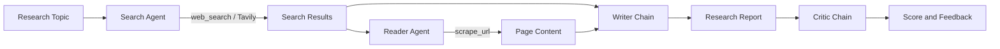

# LangChain Multi-Agent Research System

A Python research assistant that searches the web, extracts source content, generates a structured report, and critiques the result. Use the interactive Streamlit interface or run the workflow from the command line.

## Features

- Research a topic using tool-enabled search and reader agents.
- Retrieve a source title, URL, and snippet through Tavily.
- Extract readable page content with multiple fallback strategies.
- Generate a report with an introduction, key findings, conclusion, and sources.
- Review a critique with a score, strengths, improvements, and a verdict.
- Track workflow progress and download the report through Streamlit.

## Architecture

The application runs four stages sequentially. Search and reading use LangChain agents; writing and critique use prompt-model-output-parser chains. All stages share a Groq-hosted model, currently `openai/gpt-oss-120b`.



1. **Search agent:** The model calls `web_search` with a query. Tavily returns a source and a short snippet.
2. **Reader agent:** The model selects a URL and calls `scrape_url`. Requests fetches the page; Trafilatura, readability-lxml, and Beautiful Soup extract its text.
3. **Writer chain:** Combines the search results and extracted text into a structured report.
4. **Critic chain:** Evaluates the report and returns feedback. It does not automatically rewrite the report.

Both tools use `return_direct=True`: the agents return their tool results without a follow-up model summary. LangGraph handles agent execution underneath LangChain's `create_agent`. The CLI/Python pipeline stores stage outputs in a dictionary; the Streamlit interface maintains its own workflow state in `st.session_state`.

## Technology Stack

| Technology | Purpose |
| --- | --- |
| Python | Application and workflow implementation |
| LangChain / LangGraph | Agents, tool execution, prompts, and chains |
| Groq / langchain-groq | Model inference using `openai/gpt-oss-120b` |
| Tavily | Web search API |
| Streamlit | Web interface, progress display, and report download |
| Requests | HTTP page fetching |
| Trafilatura / readability-lxml | Article-content extraction |
| Beautiful Soup / lxml | HTML parsing and fallback extraction |
| Pydantic | Tool input schemas |
| python-dotenv | Loading API keys from `.env` |
| certifi | CA certificate bundle configuration |
| Rich | Console output support |

The requirements also include `langchain-openai` and `langchain-community`. The current application uses Groq, not the OpenAI API, so no OpenAI API key is required.

## Installation

### Prerequisites

- Python 3.11 or newer is recommended; the repository does not define a tested Python-version matrix.
- Git for cloning the repository.
- A [Groq API key](https://console.groq.com/keys) with access to the configured model.
- A [Tavily API key](https://app.tavily.com/).
- Internet access to the APIs and source websites. Provider quotas, rate limits, and charges may apply.

### 1. Clone the Repository

```bash
git clone https://github.com/sanjaykb1998/Lang-Chain-Multi-Agent-Research-System.git
cd Lang-Chain-Multi-Agent-Research-System
```

### 2. Create and Activate a Virtual Environment

**Windows PowerShell**

```powershell
python -m venv venv
.\venv\Scripts\Activate.ps1
```

If PowerShell blocks activation, run the following for the current terminal session, then activate again:

```powershell
Set-ExecutionPolicy -Scope Process -ExecutionPolicy RemoteSigned
.\venv\Scripts\Activate.ps1
```

**macOS / Linux**

```bash
python3 -m venv venv
source venv/bin/activate
```

### 3. Install Dependencies

With the environment active:

```bash
python -m pip install --upgrade pip
python -m pip install -r requirements.txt
```

Use a fresh environment. Dependencies are not locked to exact versions. The code requires a modern LangChain release providing `create_agent`; an older LangChain 0.2 installation is insufficient despite the lower bound in the requirements.

### 4. Configure API Keys

Create a `.env` file in the repository root, alongside `app.py`:

```dotenv
GROQ_API_KEY=your_groq_api_key
TAVILY_API_KEY=your_tavily_api_key
```

You can also supply these as environment variables. Never commit API keys or `.env`; ensure the file is excluded from version control.

The model is configured in [src/agents/agents.py](src/agents/agents.py). When changing it, choose a model available to your Groq account that supports tool calling. The `openai/` prefix in the model name does not change the API provider: inference still runs through Groq.

## Usage

### Streamlit Interface

Run from the repository root with the virtual environment active:

```bash
python -m streamlit run app.py
```

Open the URL printed by Streamlit, normally `http://localhost:8501`. Enter a topic, start research, and review the results, report, and feedback. Use the download control to export the report.

Do not start the web application with `python app.py`; it requires the Streamlit runtime.

### Command Line

```bash
python main.py
```

The default topic is "The impact of AI on the job market in 2026". Edit `topic` in [main.py](main.py) to change it. The entry point does not currently accept command-line arguments.

### Python API

```python
from src.pipelines.pipeline import run_research_pipeline

result = run_research_pipeline("Recent developments in large language models")
print(result["report"])
print(result["feedback"])
```

The returned dictionary contains `search_results`, `scraped_content`, `report`, and `feedback`. The function also prints progress and results to the console.

## Project Structure

```text
Lang-Chain-Multi-Agent-Research-System/
|-- app.py                     # Streamlit interface
|-- main.py                    # CLI entry point
|-- requirements.txt           # Python dependencies
|-- README.md
|-- LICENSE
|-- demo.excalidraw             # Excalidraw diagram
`-- src/
	|-- agents/
	|   `-- agents.py          # Agent builders and writer/critic chains
	|-- pipelines/
	|   `-- pipeline.py        # CLI/Python workflow orchestration
	`-- tools/
		`-- tools.py           # Search and page extraction tools
```

## Limitations

- Search currently requests one result and limits each snippet to 300 characters.
- Scraping returns at most 1,500 characters; the reader prompt receives at most 800 characters of search results.
- Authentication, JavaScript rendering, and anti-bot restrictions can prevent extraction. No browser automation is used for scraping.
- Scraping failures are returned as text, so a completed workflow does not guarantee useful source content.
- AI-generated reports can contain unsupported claims. Verify sources and dates; the critique is not independent fact-checking.
- Prompts and retrieved content are sent to external providers. Avoid confidential or sensitive information and respect source websites' access restrictions and content rights.
- Automated tests and a CI workflow are not currently provided in the repository.

## Troubleshooting

| Issue | Suggested Action |
| --- | --- |
| Missing or invalid API key | Check both keys in `.env` or your environment, then restart the application. |
| Groq `tool_use_failed` or a misspelled tool name | Use a Groq model with tool-calling support. Do not rename tools to match model-generated typos; prompts alone cannot guarantee valid calls. |
| Groq `model_not_found` | Check model availability for your account and update the model configuration. |
| Rate-limit errors | Check provider quotas, reduce request frequency, and follow provider retry guidance. |
| Import errors | Activate the environment, run from the repository root, and install dependencies. Upgrade `langchain` and `langchain-groq` if `create_agent` is unavailable. |
| Timeout, HTTP error, or empty content | Try an accessible public source; some websites block automated requests. |
| SSL or corporate proxy errors | Use your organization's approved CA/proxy configuration or contact its administrator. Do not disable TLS verification. |

## Contributing

Issues and pull requests are welcome. Include reproduction steps, Python/package versions, and a sanitized traceback in bug reports. Never share API keys or sensitive research content.

Fork the repository, create a focused branch, and keep each pull request scoped to one improvement. Validate the affected workflow, explain the checks performed, and update documentation when behavior or setup changes.

## License

Distributed under the [Apache License 2.0](LICENSE).